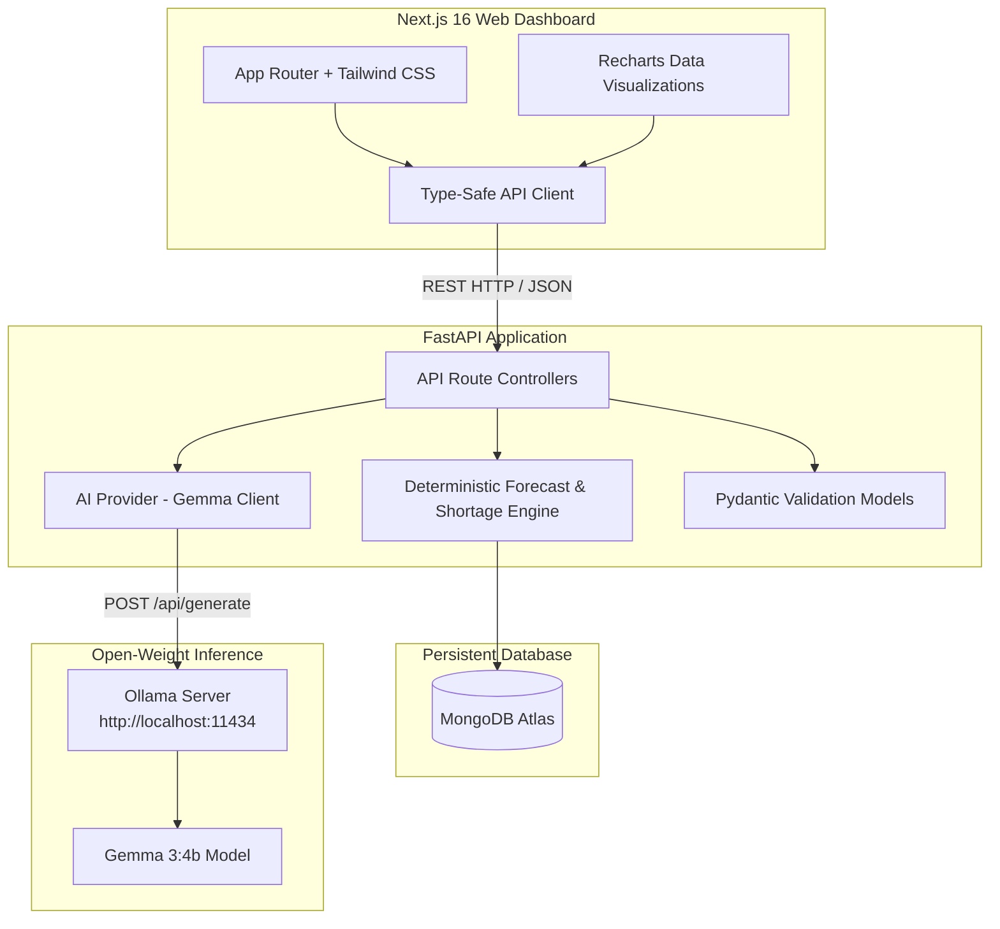

# DabbaIQ — AI Kitchen Prep & Food-Waste Planner

> **"Cook the right amount. Waste less. Earn more."**  
> An open-weight AI kitchen operations MVP built for **Hacktoberfest 2026: DEV Open-Source AI Challenge, Week 2 (Side Hustle)**.

---

## 1. Problem Statement & Target Customer

Small Indian tiffin services, home meal subscription chefs, and cloud kitchens operate under tight margins (typically 10%–15%). They face two severe daily risks:
1. **Over-preparation**: Leftover dal, curry, rice, and chapatis spoil or are discarded, destroying daily profit margins.
2. **Under-preparation**: Turning away paying subscription customers damages client retention and revenue.

Most existing ERP or POS software is designed for large restaurants, requiring costly monthly subscriptions, bar-code scanners, and complex configurations.

**DabbaIQ** is an operations dashboard that pairs **deterministic baseline demand forecasting** with **Gemma 3 open-weight AI**. It interprets informal kitchen notes, calculates portion targets, audits ingredient inventory, generates shortage shopping lists, and tracks food-waste losses.

---

## 2. Key Features

- **🍱 Kitchen Overview Dashboard (`/`)**:
  - Live morning snapshot: Planned portions, today's sales, low-stock alerts, and expiring perishables.
  - Interactive 7-day sales and portion volume chart powered by Recharts.
  - Real-time diagnostic badges for MongoDB Atlas and Ollama server connectivity.

- **✨ AI Preparation Planner (`/planner`)**:
  - **Deterministic baseline forecasting**: Averages up to 4 previous matching weekdays (e.g. Wednesday lunch), with trailing 7-day fallback and explicit explanations of observations used.
  - **Explicit safety buffer**: Configurable buffer (e.g. +15%) applied transparently after baseline calculation.
  - **Automated shortage shopping list**: Maps planned portions to recipe ingredient quantities, compares against current pantry balances with unit conversions (`kg` ↔ `g`, `L` ↔ `ml`), and calculates items to purchase with estimated cost.
  - **Gemma AI advisory**: Suggests recipe pairings from registered dishes, interprets messy handwritten kitchen notes, and generates WhatsApp menu descriptions.
  - **User confirmation workflow**: Plans stay in editable draft until explicitly confirmed by the kitchen operator.

- **📦 Inventory & Stock Control (`/inventory`)**:
  - Per-ingredient unit tracking (`kg`, `g`, `L`, `ml`, `pieces`), reorder thresholds, and unit acquisition costs.
  - Color-coded alerts for expiring perishable goods (within 3 days) and sub-threshold stock levels.
  - Quick-adjust (+1, +5, -1) buttons for fast physical stock tallying.

- **📖 Recipe Library with Dynamic Costing (`/recipes`)**:
  - Stores bill-of-materials per portion for Indian kitchen staples (*Dal Tadka*, *Steamed Rice*, *Chapati*, *Aloo Gobi*, *Mixed Veg Curry*).
  - Ingredient cost per portion is **computed in pure Python code** from live ingredient prices (never hallucinated by an LLM).
  - Multi-lingual marketing menu description generator (English, Hindi, Marathi) via Gemma.

- **🧾 Sales Log with CSV Import/Export (`/sales`)**:
  - Records meal period, recipe, portions sold, and customer revenue.
  - Full CSV template import with row-level validation and error reporting.
  - One-click CSV export for offline accounting.

- **🗑️ Leftover & Waste Tracker (`/waste`)**:
  - Compares portions prepared against portions sold to calculate leftover volume.
  - Automatically calculates estimated food-cost loss from recipe bills of materials.
  - Displays prepared-vs-sold charts and identifies top dishes causing financial waste.

- **📊 Audited Business Reports (`/reports`)**:
  - Date-range financial rollups: Total revenue, estimated ingredient expense, leftover losses, and estimated gross margin.
  - One-click CSV downloads for sales, waste, and inventory.

- **⚙️ Settings & Connectivity Diagnostics (`/settings`)**:
  - Live inspection of MongoDB Atlas and Ollama server states.
  - Copyable setup commands and configuration tips.

---

## 3. System Architecture



---

## 4. Why Open-Weight AI Matters for DabbaIQ

1. **Complete Data Privacy & Local Control**:
   - Small food businesses handle proprietary family recipes, confidential supplier wholesale prices, and customer order records.
   - With Gemma running locally via Ollama, **zero customer data or proprietary formulas leave the kitchen's premises**.
2. **Zero Recurring API Costs**:
   - Small food businesses operate on thin margins and cannot afford per-token charges or monthly SaaS AI subscriptions.
   - Gemma is free to download and run on local consumer hardware.
3. **Offline Reliability**:
   - Kitchens often have intermittent or no internet connection. Local open-weight models execute regardless of internet outages.
4. **Deterministic Separation**:
   - We do not ask the LLM to do arithmetic or invent numbers. The LLM handles unstructured text parsing and creative meal recommendations, while Python handles stock balances, costs, and forecasts.

---

## 5. Honest Limitations & Model Requirements

- **Model Sizing**: Default model is `gemma3:4b`, which requires ~3.5 GB of RAM / VRAM. For lower-resource machines, `gemma2:2b` can be configured via `OLLAMA_MODEL` in `.env`.
- **Inference Speed**: On CPU-only systems, generation takes 5–15 seconds. The UI displays non-blocking loading spinners and preserves full dashboard functionality if AI inference is delayed.
- **Localhost Endpoint Limitation**: When deployed publicly (e.g. on Render), an Ollama server running on `localhost:11434` is not accessible by remote cloud instances. In cloud production, set `OLLAMA_BASE_URL` to a reachable endpoint (e.g., a private VPS, ngrok tunnel, or cloud GPU container).
- **Food Safety Disclaimer**: DabbaIQ is an inventory and cost management tool. It does **not** replace commercial food safety guidelines, temperature logging, or HACCP regulations.

---

## 6. Installation & Setup (Windows PowerShell)

### Prerequisites
- **Python 3.11+** installed
- **Node.js 18+** & npm installed
- **Ollama** installed ([ollama.ai](https://ollama.ai))

### Step 1: Clone and Enter the Directory
```powershell
cd c:\Users\shrin\Desktop\Hactoberfest2026\DabbaIQ\dabbaiq
```

### Step 2: Set up Ollama & Gemma
In a PowerShell window:
```powershell
# Start Ollama server
ollama serve

# In a second PowerShell window, pull Gemma 3:4b
ollama pull gemma3:4b
```

### Step 3: Configure Environment Variables

**Backend Environment (`backend/.env`):**
Copy `backend/.env.example` to `backend/.env`:
```powershell
cp backend/.env.example backend/.env
```
Key variables configured in `backend/.env`:
- `MONGODB_URI`: MongoDB Atlas connection string (or leave blank for unconfigured in-memory demo).
- `MONGODB_DATABASE`: Target database name (default: `dabbaiq`).
- `AI_PROVIDER`: `ollama` (default).
- `OLLAMA_BASE_URL`: URL to inference server (default: `http://localhost:11434`).
- `OLLAMA_MODEL`: Target model (default: `gemma3:4b`).
- `ELEVENLABS_API_KEY`: *(Optional)* Speech-to-text for kitchen voice notes.
- `BACKBOARD_API_KEY`: *(Optional)* Persistent operational assistant threads.
- `TINKER_API_KEY`: *(Optional)* Open-weight fine-tuning dataset generation.
- `APP_ENV`: `development` or `production`.
- `FRONTEND_ORIGIN`: `http://localhost:3000` (for CORS).

**Frontend Environment (`frontend/.env.local`):**
Configure in `frontend/.env.local`:
```ini
NEXT_PUBLIC_API_BASE_URL=http://localhost:8000/api
```

### Step 4: Install Backend Dependencies & Run Tests
```powershell
cd backend
pip install -r requirements.txt

# Run the automated test suite (47 tests across units, schemas, forecasts, and integrations)
python -m pytest tests/ -v
```

### Step 5: Seed Demonstration Data
```powershell
# From the dabbaiq/ root:
python scripts/seed_demo.py
```
*This populates 14 days of realistic meal sales, pantry ingredients, 5 Indian recipes, and leftover records, all clearly tagged as `is_demo=true`. The script is duplicate-safe and checks for existing demo records.*

### Step 6: Start Backend API
```powershell
cd backend
uvicorn app.main:app --reload --host 127.0.0.1 --port 8000
```
*API docs available at [http://127.0.0.1:8000/docs](http://127.0.0.1:8000/docs).*

### Step 7: Start Next.js Frontend
In a new terminal:
```powershell
cd dabbaiq/frontend
npm install
npm run dev
```
*Open [http://localhost:3000](http://localhost:3000) in your browser.*

---

## 7. Automated Test Suite

Run all 47 automated tests:
```powershell
cd dabbaiq/backend
python -m pytest tests/ -v
```

### Covered Test Scenarios (47 Tests):
1. **Unit Compatibility**: `kg` ↔ `g` and `L` ↔ `ml` conversions, incompatible unit rejections.
2. **Schema Validations**: Negative quantities, empty names, zero-portion sales, and waste validation.
3. **Forecast Logic**:
   - Sufficient weekday history (averaging matching weekdays).
   - Insufficient history (falling back to trailing 7-day average).
   - Zero historical data (manual override flag).
4. **Cost Calculations**: Leftover financial loss, recipe portion costing, ingredient shortage delta.
5. **CSV Import Validation**: Valid rows, bad date formats, invalid meal periods, negative portions.
6. **AI Response Parsing**: Extraction from markdown code blocks, schema compliance, error recovery.
7. **Environment & Integration Tests**:
   - Default configuration values and database name fallbacks.
   - CORS origin resolution with `FRONTEND_ORIGIN`.
   - Live MongoDB health diagnostics and failure classifications.
   - ElevenLabs STT audio file size limit validation.
   - Optional partner status reporting (Backboard, Tinker) when keys are absent.
   - Duplicate-safe demo seeding logic.

---

## 8. Deployment on Render

### Deploying the Backend (Web Service)
1. In `Render.com`, create a new **Web Service** connected to your repo.
2. Root Directory: `dabbaiq/backend`
3. Environment: `Python`
4. Build Command: `pip install -r requirements.txt`
5. Start Command: `uvicorn app.main:app --host 0.0.0.0 --port $PORT`
6. Environment Variables:
   - `MONGODB_URI`: Your MongoDB Atlas connection string.
   - `CORS_ORIGINS`: Your frontend URL (e.g. `https://dabbaiq.onrender.com`).
   - `OLLAMA_BASE_URL`: URL to a cloud-reachable Ollama instance (or leave default for offline fallback).

### Deploying the Frontend (Web Service or Static Site)
1. Create a new **Web Service** or **Static Site** on Render.
2. Root Directory: `dabbaiq/frontend`
3. Build Command: `npm install && npm run build`
4. Start Command: `npm start`
5. Environment Variables:
   - `NEXT_PUBLIC_API_URL`: URL of your deployed backend (e.g. `https://dabbaiq-api.onrender.com/api`).

> **⚠️ Cloud Deployment Note on Ollama**: A web application deployed to Render cannot connect to `localhost:11434` on your home computer. For cloud deployment, you must host Ollama on an accessible server (e.g., a GPU VM on RunPod, Modal, or a VPS) or use DabbaIQ's deterministic mode which functions 100% reliably even when AI inference is offline.

---

## 9. Challenge Partner Categories Used

- **Ollama / Gemma 3**: Local open-weight inference for unstructured kitchen note parsing, grounded recipe synthesis, and multi-lingual marketing copy.
- **MongoDB Atlas**: Cloud document database for ingredients, recipes, sales, prep plans, and waste collections.

---

## 10. Demo Video Checklist

- [ ] Showcase tagline and Kitchen Overview Dashboard (`/`).
- [ ] Point out live MongoDB and Ollama status badges in the navigation bar.
- [ ] Open AI Preparation Planner (`/planner`), set tomorrow's lunch date, input phone advance orders and unstructured kitchen notes.
- [ ] Click "Generate Plan" and demonstrate the deterministic forecast breakdown, the 15% safety buffer, and the shortages shopping list.
- [ ] Highlight Gemma's grounded reasoning and menu suggestion.
- [ ] Confirm the plan to update the active kitchen dashboard.
- [ ] Show Recipe library (`/recipes`) with live computed cost per portion (₹13.40 for Dal Tadka) and multi-lingual marketing generator.
- [ ] Show Waste Tracker (`/waste`) with prepared vs. sold comparison and estimated financial losses.
- [ ] Download a Sales CSV report from Reports (`/reports`).

---

## 11. User Testing Findings & Iterations

During initial user testing with a home tiffin cook:
1. **Feedback**: *"I don't know my exact portion demand for new recipes."*  
   **Iteration**: Implemented the fallback to trailing 7-day average, plus a clear "Manual / No History" message that encourages the chef to enter a number rather than inventing false numbers.
2. **Feedback**: *"I write rough notes on a sticky pad like 'Sharma wants 5 extra rotis'."*  
   **Iteration**: Created the AI kitchen note parser that turns unstructured sentences into candidate orders and requests confirmation before saving.
3. **Feedback**: *"Never let AI guess my spices or stock!"*  
   **Iteration**: Isolated all calculations (inventory deductions, recipe costs, shortage quantities) to pure Python code; Gemma strictly advises on menu combinations and notes.

---

## License

MIT License. Open-source for Hacktoberfest 2026.
