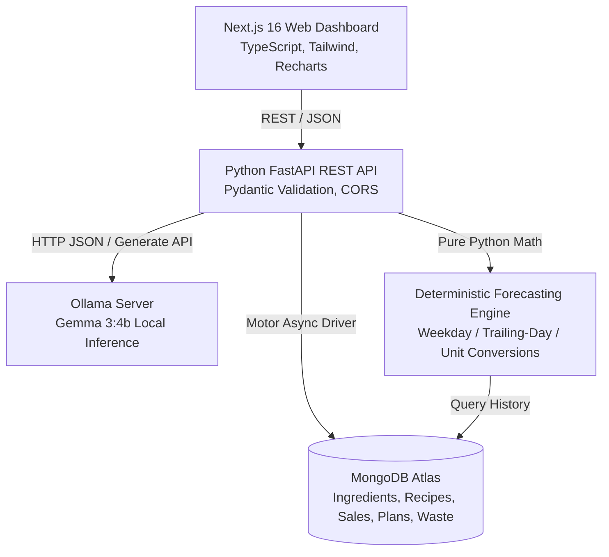

# DabbaIQ System Architecture

## Overview

**DabbaIQ** is an operations intelligence and food-waste reduction platform designed specifically for small Indian tiffin services, cloud kitchens, and home caterers.

Tagline: *"Cook the right amount. Waste less. Earn more."*

---

## 1. Core Principles

1. **Deterministic Core, AI Advisory Layer**:
   - Stock quantities, unit conversions, recipe ingredient costs, shortage totals, and baseline demand calculations are **never delegated to a language model**. They are calculated with standard, verifiable Python math.
   - The open-weight model (Gemma 3) is strictly used as an advisory and semantic layer: interpreting messy, informal kitchen notes, suggesting grounded recipe combinations from registered dishes, and generating multi-lingual marketing descriptions.

2. **Zero Hallucination Grounding**:
   - Every recipe ID recommended by Gemma is checked against MongoDB to prevent hallucinated dishes.
   - Gemma receives bounded JSON containing only registered recipes, real-time inventory balances, and computed baseline forecasts.

3. **Graceful Degradation**:
   - If the database is disconnected, the server boots without crashing, surfaces clear warnings across all pages, and allows in-memory inspection.
   - If Ollama is offline or the model is still loading, all core kitchen operations (sales logging, inventory updates, deterministic prep calculations, shortage lists, reports) continue functioning without interruption.

---

## 2. Component Details

### Frontend (`frontend/`)
- **Next.js 16 (App Router)** with TypeScript
- **Tailwind CSS v4** with a custom kitchen design system:
  - Warm ivory background (`#FDFBF7`)
  - Deep forest-green primary (`#1B4332`, `#2D6A4F`)
  - Restrained warm amber/orange accents (`#D97706`, `#B45309`)
- **Recharts** for visualizations:
  - 7-day sales and portions trend chart
  - Prepared vs. Sold portion comparison chart
- **Live Health Diagnostics**:
  - Live header pills displaying MongoDB and Ollama status.

### Backend (`backend/app/`)
- **FastAPI**: High-performance asynchronous REST API.
- **Pydantic v2**: Strict validation for all payloads and LLM outputs.
- **Motor / PyMongo**: Async MongoDB driver with indexes on `date`, `meal_period`, and `recipe_id`.
- **Forecast Service (`services/forecast.py`)**:
  - Weekday matching: Averages up to 4 previous matching weekdays (e.g. previous Wednesdays for Wednesday lunch).
  - Trailing fallback: Averages the trailing 7 days if weekday observations are fewer than 2.
  - Manual override flag: Returns clear explanation when no historical data exists.
  - Configurable safety buffer (default 15%) applied explicitly to baseline.
- **AI Provider (`services/ai_provider.py`)**:
  - Interacts with Ollama via HTTP POST to `/api/generate`.
  - JSON extraction engine with markdown fence stripping and fallback delimiters.
  - Validates output against `AIMenuSuggestion` and `AIParseResponse` Pydantic models.

---

## 3. Data Collections Schema

| Collection | Key Fields | Description |
| :--- | :--- | :--- |
| `ingredients` | `name`, `category`, `quantity`, `unit`, `reorder_level`, `cost_per_unit`, `expiry_date`, `is_demo` | Raw pantry ingredients with units (kg, g, L, ml, pieces) |
| `recipes` | `name`, `meal_category`, `ingredients` (id, qty, unit), `estimated_cost_per_portion`, `prep_notes`, `dietary_labels` | Dishes with per-portion ingredient requirements |
| `sales` | `date`, `meal_period`, `recipe_id`, `recipe_name`, `portions_sold`, `revenue`, `is_demo` | Historical sales records used for demand forecasting |
| `plans` | `target_date`, `meal_period`, `recipes`, `shopping_list`, `forecasts`, `estimated_total_cost`, `is_confirmed` | Prepared batch plans and purchase shortage requirements |
| `waste` | `date`, `meal_period`, `recipe_id`, `portions_prepared`, `portions_sold`, `leftover_portions`, `estimated_waste_cost`, `reason` | Post-service leftover logging and cost loss audit |

---

## 4. Open-Weight AI Architecture: Why Gemma Matters

1. **Local Privacy**: Small food businesses handle proprietary recipe formulas, supplier pricing, and customer orders. Gemma runs locally on the kitchen computer via Ollama — zero customer or cost data ever leaves the premises.
2. **Offline Resilience**: Kitchens frequently suffer unstable network connectivity. Local open-weight inference ensures planning never stops during an internet outage.
3. **No Per-Token Billing**: Small food businesses operate on thin margins (often 10–15%). Free local inference removes ongoing API costs.
